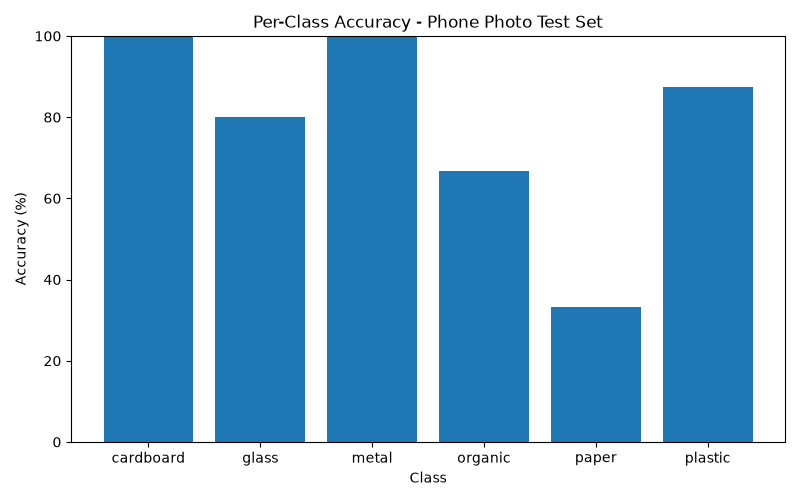
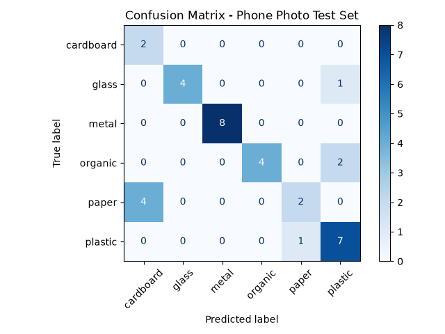

# Baseline Model Results

## Model

The baseline model uses MobileNetV2 with transfer learning.

- Dataset: MWCD
- Classes: 6
- Image size: 224 × 224
- Batch size: 32
- Epochs: 5

## Overall Results

- Training accuracy: 91.89%
- Validation accuracy: 88.98%
- Training loss: 0.2374
- Validation loss: 0.3094
- Approximate training time: 24 minutes
- Model size: 9.3 MB

## Per-Class Accuracy

The model performance for each class was:

- Cardboard: 92.40%
- Glass: 91.01%
- Metal: 89.50%
- Organic: 97.25%
- Paper: 87.46%
- Plastic: 80.55%

## Confusion Matrix

The confusion matrix shows how often each actual class was predicted as another class.

The main classification errors were:

- Plastic classified as glass: 86 images
- Paper classified as cardboard: 59 images
- Glass classified as plastic: 43 images
- Plastic classified as metal: 39 images

Plastic had the lowest per-class accuracy and was most often confused with glass.

Paper and cardboard also showed some confusion.

## Conclusion

The baseline model achieved a validation accuracy of 88.98%.

Organic had the highest per-class accuracy at 97.25%, while plastic had the lowest accuracy at 80.55%.

These results will be used as the baseline when testing improvements such as model tuning, data augmentation, and alternative lightweight models.

## Evaluation Metrics and Acceptance Criteria

### Evaluation Metrics

The waste classification model will be evaluated using the following metrics:

- **Accuracy:** The proportion of all evaluated images classified correctly.
- **Precision:** For each class, the proportion of images predicted as that class that actually belong to it.
- **Recall:** For each class, the proportion of images belonging to that class that are correctly identified.
- **F1-score:** The harmonic mean of precision and recall for each class.
- **Macro-averaged precision, recall, and F1-score:** The unweighted average of the respective metric across all six classes.
- **Confusion matrix:** Shows correct predictions and misclassifications across the six waste classes.
- **Per-class accuracy:** Measures the proportion of images in each actual class that are correctly classified.
- **Loss:** Measures prediction error and is used to monitor model training and validation.

The six classes are cardboard, glass, metal, organic, paper, and plastic.

### Baseline Reference

The existing baseline model uses MobileNetV2 with transfer learning and achieved 88.98% validation accuracy. The reported per-class accuracy ranges from 80.55% for plastic to 97.25% for organic.

These baseline results will be used to compare future model improvements. Validation results must not be presented as test results.

### Acceptance Criteria

The following are proposed initial criteria for model evaluation:

- Overall accuracy should aim for at least 88% on a held-out test dataset. This is a provisional target and should be reviewed after test results are available.
- Precision, recall, and F1-score must be reported for each class, along with macro averages.
- A confusion matrix and per-class accuracy results must be produced for each evaluation run.
- Evaluation must use a consistent, held-out test dataset that is separate from the training data.
- Misclassification patterns, especially plastic versus glass and paper versus cardboard, must be reviewed.
- Future model improvements must be compared with the baseline using the same test dataset and evaluation procedure.

The evaluation script and calculated metrics will be addressed in the implementation work. Acceptance targets may be revised based on test results and project requirements.
